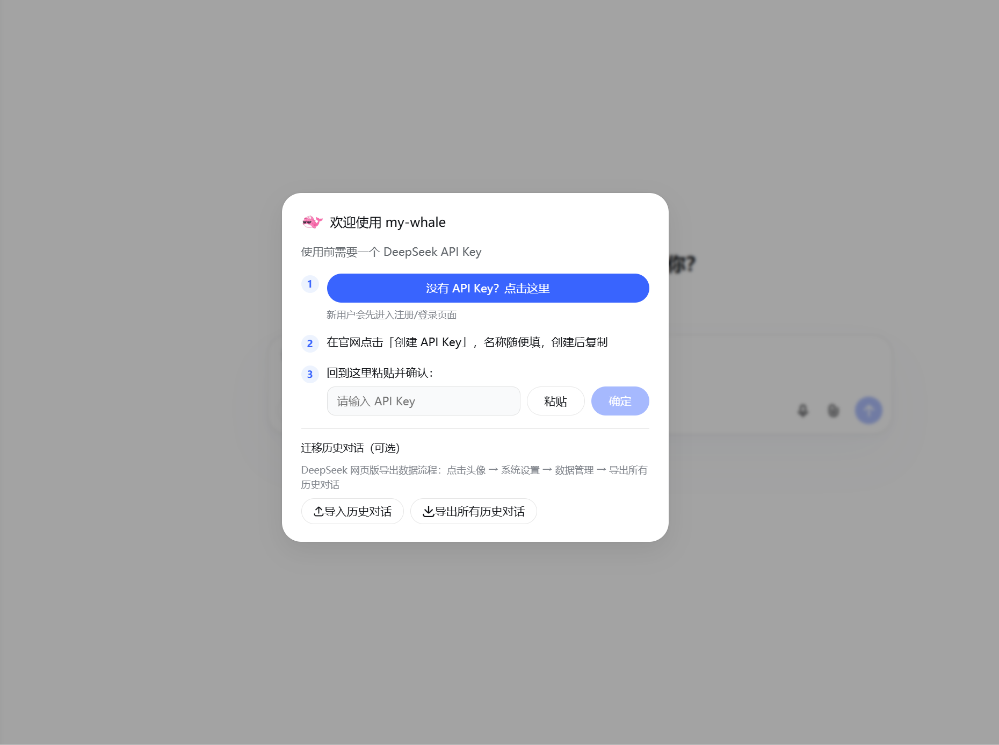
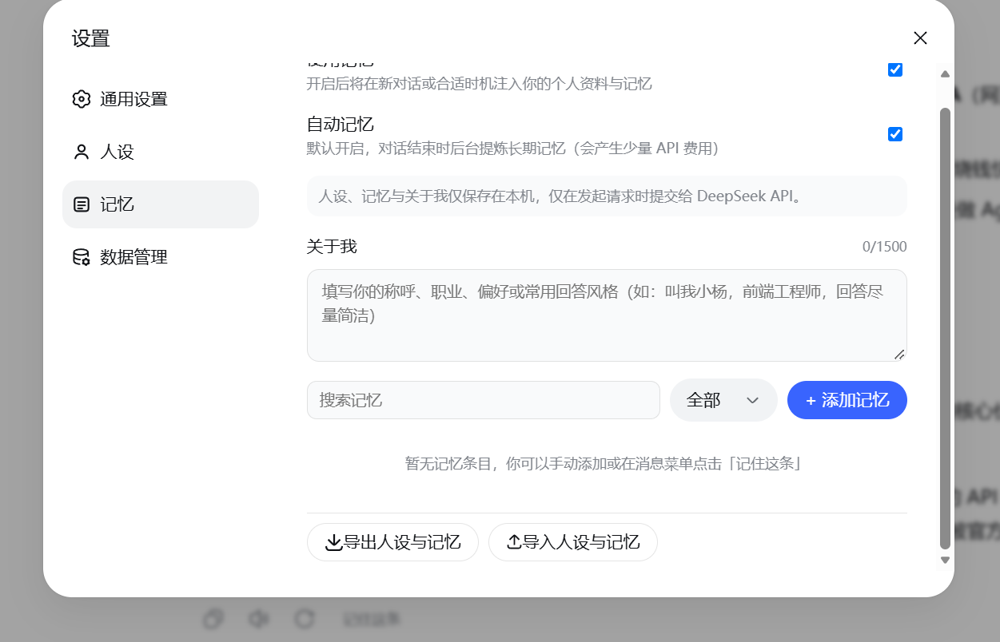
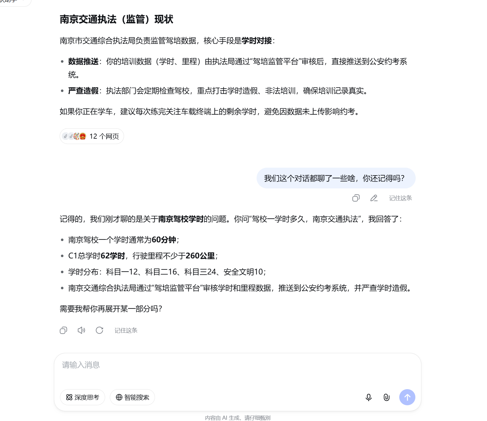

<div align="center">
  
  <h1>my-whale</h1>
  <p>基于 <code>deepseek-ai/chat-demo</code> 二次开发的本地优先 DeepSeek 第三方全端客户端（Web / iOS PWA + Android + Tauri 桌面端）</p>
  <p>支持零后端本地直连 DeepSeek API、引导配 Key 与余额监控、自定义人设、全局与单对话局部记忆、历史对话 ZIP v3 无损迁移。</p>
</div>

---

> **声明 / Notice**：本项目（`my-whale`）基于 [deepseek-ai/chat-demo](https://github.com/deepseek-ai/chat-demo)（MIT 协议）进行二次开发，属于**第三方开源客户端，并非 DeepSeek 官方应用**。所有 API Key、对话记录、人设与记忆数据均仅保存在本地设备，仅在发起对话或后台提炼记忆时直连 DeepSeek 官方 API。

## 界面演示（按使用顺序）

### 1. 首次启动引导与数据迁移
引导获取、复制并验证 DeepSeek API Key，支持一键粘贴并可在首次启动时直接导入 DeepSeek 网页版导出的历史对话压缩包。



### 2. 全局记忆、「关于我」与后台提炼设置
支持配置「使用记忆」与「自动记忆」、填写全局「关于我」档案、搜索/分类/置顶/导入导出全局记忆条目，并支持一键从当前对话提炼记忆。



### 3. 导入历史后的对话上下文与「记住这条」
导入 DeepSeek 网页版历史对话压缩包后即可无缝延续原有上下文；每条消息下方均提供「记住这条」，支持一键存入全局记忆或当前对话的局部记忆。



---

## 核心特性

### 1. 引导配 Key 与余额监控
- **零门槛引导**：内置 DeepSeek 开放平台创建 Key 的步骤指引、系统默认浏览器跳转（适配 Android 与桌面端）、剪贴板一键粘贴与格式校验。
- **实时余额与安全提示**：侧边栏及设置页实时查询并展示赠金 / 充值余额；附带「官网用量」快捷入口与 API Key 泄露排查提示，支持随时退出/清除本地 API Key。

### 2. 自定义人设与试聊机制
- **自定义人设**：支持创建、编辑、复制人设，支持上传头像图片（自动压缩并限制体积）、设置默认人设与开场白、配置人设级默认「深度思考 / 智能搜索」开关。
- **试聊与保存**：试聊会话默认不污染左侧历史列表，支持一键「保存到对话列表」转正为持久会话。
- **会话级快照与热更新**：历史会话保留创建时的人设快照；当人设模板修改后，会话顶部会提示是否同步更新。

### 3. 双层记忆系统（全局记忆 + 单对话局部记忆）
- **全局记忆与「关于我」**：在 `设置 → 记忆` 中维护全局「关于我」个人背景与长期记忆条目，跨对话按规则注入系统提示词。
- **单对话局部记忆与隔离模式**：
  - 每个对话独立维护自己的 `localMemories`，可在会话人设面板中查看、手动添加或删除。
  - 默认模式为「全局记忆 + 本对话局部记忆」。
  - 可在单个对话中勾选**「仅使用本对话局部记忆（不用全局记忆）」**：开启后该对话将跳过「关于我」与全局记忆，且该对话产生的「自动记忆」仅写入本对话的局部记忆。
  - 在消息操作中点击**「记住这条」**时，可自由选择保存到「全局记忆」或「本对话局部记忆」。
- **后台自动提炼 + 手动即时提炼**：对话完成一轮后自动在后台静默提炼高价值记忆（打开设置弹窗时立即触发待执行任务）；同时在 `设置 → 记忆` 提供「从当前对话提炼」按钮随时触发并提示结果。
- **无痕会话**：开启无痕后不读取任何全局/局部记忆，也不写入任何自动记忆。

### 4. 数据迁移与多端互通
- **ZIP v3 历史归档**：兼容 DeepSeek 官方网页版导出的历史对话 ZIP（v3 格式），完整保留分支树、图片附件、会话人设快照、局部记忆及隔离配置；Android 端支持通过系统文件选择器导入与系统分享/下载目录导出。
- **人设与记忆备份（`my-whale-profile.json`）**：支持一键导出/导入个人人设、全局记忆与「关于我」，支持合并或替换两种模式。

### 5. 全端覆盖（Web / iOS PWA / Android / Tauri 桌面端）
- **Web 端 & iOS PWA**：React 18 + TypeScript + Zustand + IndexedDB（`idb`）+ Rspack，支持流式 SSE、深度思考、智能搜索、链接阅读、GFM Markdown、KaTeX 公式、Prism 代码高亮与 Mermaid 图表；内置 `manifest.webmanifest` 与离线 Service Worker，支持通过 GitHub Pages 纯静态部署并由 iPhone Safari「添加到主屏幕」作为全屏 PWA 使用。
- **Android 端**：基于 Capacitor 8 打包为原生 APK，适配 Android 15/16 Edge-to-Edge 状态栏安全区与软键盘视口，通过 `@capacitor/browser`（调用系统默认浏览器）、`@capacitor/clipboard`、`@capacitor/filesystem` 与 `@capacitor/share` 对接原生系统能力。
- **桌面端（Tauri v2）**：轻量级原生桌面壳，直接复用 `web/dist` 构建 Windows（`.exe` / `.msi`）与 macOS（`.dmg`）安装包，支持调用系统默认浏览器打开官网控制台与本地文件导入导出。
- **语音模式开关**：语音输入（麦克风）与回复朗读默认关闭，可在 `设置 → 通用设置 → 语音模式` 中按需开启。

> **测试覆盖说明**：开发者日常使用 Android 与 Windows 设备，未持有 iPhone / iPad / Mac 设备进行实机测试；iOS PWA 与 macOS 构建产物基于标准 Web 规范与 GitHub Actions 自动化流程提供，尚未经过苹果端真机实测，欢迎苹果设备用户反馈使用体验。

---

## 目录结构

```text
my-whale/
├── web/                              # Web 前端与 iOS PWA 源码
│   ├── public/                       # PWA 清单、Apple 桌面图标与 Service Worker
│   ├── src/
│   │   ├── components/               # UI 组件（对话、引导、人设、记忆、设置等）
│   │   ├── services/                 # API、余额、对话状态、历史 ZIP、人设、记忆逻辑
│   │   ├── platform/                 # Capacitor / Tauri 原生桥接
│   │   └── i18n/                     # 中英文国际化文案
│   ├── capacitor.config.ts           # Capacitor Android 工程配置
│   └── package.json
├── desktop/                          # Tauri v2 轻量桌面端工程
├── android/                          # Android 原生工程（Gradle + Capacitor）
├── site/                             # GitHub Pages 官网引导页（首页 + /app/）
├── .github/workflows/                # GitHub Pages 部署与 v* Tag 多端发版工作流
├── docs/                             # 架构与迁移设计文档
└── resources/png/                    # README 与官网演示截图
```

---

## 快速开始

### 环境要求
- Node.js >= 20 & pnpm
- Android 构建（可选）：JDK 21 + Android SDK（Android Studio）
- 桌面端构建（可选）：Rust 工具链（`rustc` / `cargo`）与对应平台构建工具（Windows WebView2）

### 1. 运行 Web 端

```bash
cd web
pnpm install
pnpm dev
```

常用检查与构建命令：

```bash
pnpm type      # TypeScript 类型检查
pnpm lint      # Oxlint 代码规范检查
pnpm build     # 生产构建（输出到 web/dist）
```

### 2. 构建 Android APK

先编译 Web 产物并同步到 Android 工程：

```bash
cd web
pnpm android:sync
```

然后使用 Gradle 构建 Debug APK（需确保环境变量 `JAVA_HOME` 指向本机 JDK 21，且 `ANDROID_HOME` 指向 Android SDK）：

```bash
# macOS / Linux
cd ../android
./gradlew assembleDebug --no-daemon

# Windows (PowerShell)
cd ..\android
.\gradlew.bat assembleDebug --no-daemon
```

构建完成后 APK 位于：

```text
android/app/build/outputs/apk/debug/app-debug.apk
```

### 3. 构建 Tauri v2 桌面端

```bash
cd desktop
pnpm install
pnpm build
```

Windows 安装包输出在 `desktop/src-tauri/target/release/bundle/`（包含 `.exe` 与 `.msi`）。

### 4. GitHub Pages 与多端自动发版
- **GitHub Pages（Web / iOS PWA）**：在仓库 **Settings → Pages → Build and deployment → Source** 选择 **GitHub Actions**，推送 `main` 后会自动部署官网引导页（`/`）与 PWA 应用（`/app/`）。
- **GitHub Releases 自动打包**：推送 `v*` 标签（如 `git tag v0.1.0 && git push origin v0.1.0`）即可自动构建 Android APK 与 Windows / macOS 桌面端安装包并发布到 Releases。

---

## 隐私与计费提示

1. **本地存储**：API Key、对话历史（IndexedDB）、人设与记忆均保存在用户本机，无第三方中转服务器。
2. **计费说明**：正常对话以及开启「自动记忆 / 从当前对话提炼」均按 DeepSeek 官方 API 标准计费，请留意余额与官网用量。
3. **Key 安全**：请勿泄露个人 API Key；若侧边栏余额出现异常变动，请立即前往 DeepSeek 官网查看用量并轮换 Key。

---

## 开源协议

本项目基于 **MIT License** 开源，衍生自 [deepseek-ai/chat-demo](https://github.com/deepseek-ai/chat-demo)（MIT License）。
