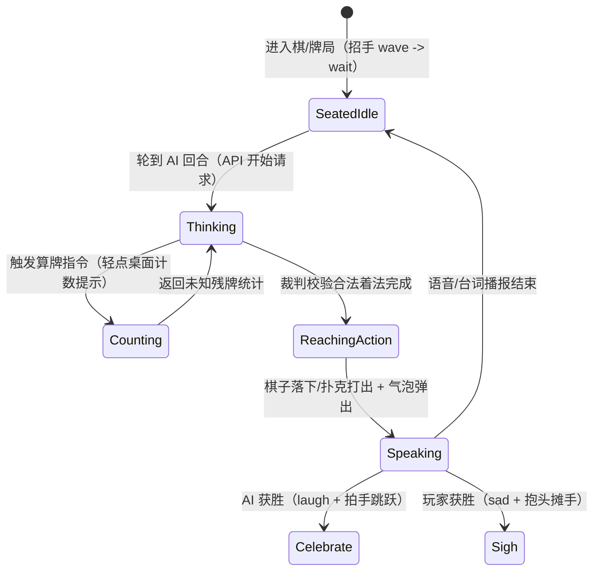

# 2.5D 桌宠对坐游戏交互开发文档

> 本文档规划 `my-whale` 游戏模块（五子棋 / 中国象棋 / 斗地主 / 麻将）的下一阶段体验升级：**让桌宠真正“坐”在 2.5D 棋牌桌对面或左右席位，与玩家面对面思考、落子、抓牌、出牌与互动**。

---

## 1. 现状与演进目标

- **当前状态**：棋盘/牌桌已采用 `perspective` 2.5D 立体倾斜渲染，桌宠头像（8×9 精灵图）展示在顶部或牌桌席位卡片内，随 AI 状态切换 `idle / think / speak / laugh / sad / wait` 动作。
- **目标体验**：
  1. **空间共在感**：桌宠半身或全身坐在棋盘对岸 / 牌桌三侧边缘的「木质桌沿或软垫席位」上，视角深度与棋盘透视角度（`rotateX(12deg~18deg)`）统一。
  2. **实时动作响应**：思考过程不再只是静静转圈，桌宠会低头托腮推演；决定出手的一瞬间会执行**探身 / 落子 / 摸牌 / 亮牌**物理动画与桌面微震效果。
  3. **零门槛兼容通用桌宠库**：任何用户通过「宠物自选库」上传的 `8×9` 精灵图或单图，无需重绘新帧即可自动享受整套 2.5D 入座与出手动作。

---

## 2. 统一 2.5D 舞台与席位坐标系

### 2.1 三类标准桌局席位布局

| 局类型 | 适用游戏 | 桌宠席位位置 | 镜头与透视 |
| --- | --- | --- | --- |
| **双人对坐桌** | 五子棋、中国象棋 | 正上方对岸（`top-center`）略微俯视面向玩家 | 棋盘 `rotateX(15deg)`，桌宠锚定在棋盘后缘 `translateZ(18px)` |
| **三人三角桌** | 斗地主 | 左上角（上家）+ 右上角（下家）斜向面向牌桌中央 | 牌桌 `rotateX(12deg)`，左右桌宠分别朝内旋转 `±10deg` |
| **四人四向桌** | 麻将 | 左 / 正上 / 右三席面向中央牌河 | 四方立牌各自按座席法线倾斜 |

---

## 3. 桌宠行为状态机（Synced with LLM & Referee）



### 各阶段表现设计
1. **Thinking（思考中）**：
   - 当 DeepSeek 开启深度思考流式输出 `thinking_delta` 时，精灵图切换 `think` 动作帧，头顶保留轻量「思路涟漪」；可随思考字数微妙加速眨眼/点头频次。
2. **ReachingAction（出手物理反馈 · 非破坏性叠加层）**：
   - **关键设计**：由于内置及用户上传宠物统一遵循标准 `8×9` 动作格（或单图），不强制要求额外绘制第 10~12 排手部帧，而是采用 **「躯干前倾 + 悬浮阴影缩放 + 目标道具飞行叠加层」**：
     - **五子棋 / 象棋**：桌宠本体短暂前倾 (`translateY(4px) scale(1.05)`) 并切换 `runRight/wave` 短帧 `260ms`，同时一枚带拖尾阴影的棋子（`360ms cubic-bezier`）从该桌宠席位坐标平滑飞入棋盘目标交叉点，落地瞬间伴随轻量水波纹或木桌落子轻音。
     - **斗地主 / 麻将**：桌宠前倾时，一组背面翻转卡片/麻将牌从桌宠席位弧线甩入桌面出牌区并翻开正面；出「王炸 / 炸弹 / 胡牌」时附加 `screen-shake (2px)` 与金边高亮光效。

---

## 4. 桌宠专属语音包架构（面向后续扩展）

为配合第 3 期斗地主自定义桌宠玩家与未来专属语音包扩展，统一扩展 [`PetDefinition`](file:///E:/my-whale/web/src/pet/catalog.ts) 上的 `voicePack` 协议：

```ts
export type PetVoiceCueCategory =
  | 'greet'
  | 'bid'
  | 'pass'
  | 'rocket'
  | 'bomb'
  | 'straight'
  | 'lowCards'
  | 'win'
  | 'lose'

export type PetVoicePack = {
  id: string
  /** 优先使用的在线/系统 TTS 音色 */
  preferredVoice?: 'stella' | 'tide'
  /** 可选：按事件映射本地预录音频（MP3/OGG/WAV DataURL 或静态资源） */
  clipMap?: Partial<Record<PetVoiceCueCategory, string[]>>
  /** 可选：该角色口癖台词兜底词库 */
  flavorLines?: Partial<Record<PetVoiceCueCategory, string[]>>
}
```

### 播放优先级回退链
1. 若开启语音且命中当前动作事件对应本地音频剪辑 `clipMap[category]`，直接低延迟播放本地原声语音包；
2. 否则使用模型返回的真人台词（或 `flavorLines` 增强句），按 `voicePack.preferredVoice` 请求 TTS 合成朗读；
3. 若关闭语音，仅保留角色说话嘴型动画（`speak`）与桌面气泡展示。

---

## 5. 分期落地计划

- **Phase 1（视觉入座）**：抽取通用 `<SeatedPetActor />` 组件，在五子棋与象棋棋盘后缘升级 2.5D 对坐台阶，统一斗地主左右席位的桌宠立绘阴影与前倾动画。
- **Phase 2（抛物线出牌/落子动效）**：记录席位 DOM 锚点到棋盘格/出牌区的坐标映射，用 WAAPI / CSS Transition 实现 350ms 落子与飞牌轨迹。
- **Phase 3（专属语音包导入）**：允许用户在「宠物自选库」上传桌宠包时附带 `voice/` 音频文件夹，实现完全自定义的桌宠形象 + 专属语音包闭环。
