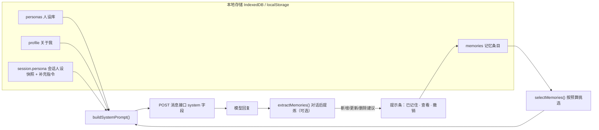
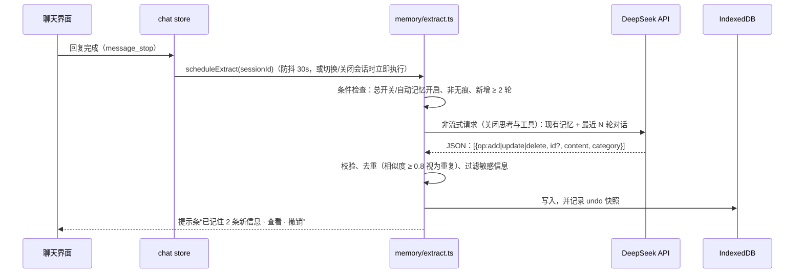

# my-whale 二次开发文档（二）：对话人设与全局记忆

> 基线代码：`vender/chat-demo`（v0.1.1）　依赖文档：《二次开发文档-引导与余额》
> 文档日期：2026-11-17　适用平台：Web + Android（Capacitor 封装，代码共用）

---

## 1. 目标

| # | 能力 | 说明 |
|---|------|------|
| P1 | **人设库** | 用户可以创建、编辑、删除、复制人设（名称、头像、简介、人设指令、开场白）；内置几个示例模板 |
| P2 | **会话人设** | 新建会话时选择人设，整个会话都按该人设回答；会话中也可以随时切换或微调 |
| P3 | **会话补充指令** | 只对当前会话生效的补充要求，例如“这次只用英文回答” |
| M1 | **关于我** | 一段全局的个人信息和偏好（称呼、职业、回答风格等），所有会话共享 |
| M2 | **全局记忆** | 由多条记忆组成：用户可以手动添加，也可以让模型在对话后自动提炼；支持查看、编辑、删除、停用 |
| M3 | **记忆控制** | 总开关、自动记忆开关、“无痕会话”（本次会话既不读取也不写入记忆）、新记忆提示与撤销 |
| M4 | **备份迁移** | 人设和记忆可以导入导出，并与现有的历史 ZIP 兼容 |

**设计原则**
- 所有数据**只保存在本地**（IndexedDB / localStorage），只有发起请求时才拼进上下文发送给 DeepSeek API。
- 用户能看到、能修改、能关闭模型“记住了什么”，不在用户不知情的情况下写入记忆。
- 尽量把新功能放在新文件里，对上游文件少做改动，方便以后合并上游更新。

---

## 2. 现状分析

请求体在 [store.ts](file:///e:/my-whale/vender/chat-demo/src/services/chat/store.ts#L998-L1012) 里组装：

```ts
streamMessage(apiKey, {
  model: initial.model ?? MODEL,
  system: SYSTEM_PROMPT,          // ← 固定字符串：'该助手为DeepSeek，由深度求索公司创造。'
  messages,                       // ← toRequestMessages() 生成，每轮前带 latest_reminder（日期/地区/语言）
  thinking, safety_check, tools, title,
}, signal)
```

- 目前只有一个固定的 `SYSTEM_PROMPT`（[store.ts L38](file:///e:/my-whale/vender/chat-demo/src/services/chat/store.ts#L38)），用户无法修改。
- `Session` 类型（[types.ts](file:///e:/my-whale/vender/chat-demo/src/services/chat/types.ts)）只有 `id/title/messages` 等字段，没有任何人设相关信息。
- IndexedDB 当前版本为 `DB_VERSION = 11`（[db.ts](file:///e:/my-whale/vender/chat-demo/src/services/chat/db.ts#L5)）。

**改造的核心**：把固定的 `system` 换成由 `buildSystemPrompt(session)` 动态拼出来的内容。

---

## 3. 总体架构



### 3.1 系统提示词的拼装顺序

从上到下优先级递减，越靠前的部分越不应被后面的内容覆盖：

```text
[1] 基础规则      固定，不可编辑：安全底线 + “以下设定由用户提供”
[2] 人设          会话快照中的人设指令（未选择人设时使用默认助手身份）
[3] 会话补充指令  只对当前会话生效
[4] 关于用户      “关于我”
[5] 记忆          挑选出的记忆条目，带编号
[6] 记忆使用规则  “只在相关时自然地运用，不要逐条复述；与当前对话冲突时以当前对话为准”
```

示例模板（`services/persona/prompt.ts`）：

```ts
export const buildSystemPrompt = (ctx: PromptContext): string => {
  const parts: string[] = [BASE_RULES]
  parts.push(ctx.persona?.instructions?.trim() || DEFAULT_IDENTITY)
  if (ctx.sessionNote?.trim()) parts.push(`## 本次会话的额外要求\n${ctx.sessionNote.trim()}`)
  if (ctx.memoryEnabled && !ctx.incognito) {
    if (ctx.profile?.trim()) parts.push(`## 关于用户\n${ctx.profile.trim()}`)
    if (ctx.memories.length) {
      parts.push(
        `## 关于用户的记忆\n${ctx.memories.map((m, i) => `${i + 1}. ${m.content}`).join('\n')}\n\n` + MEMORY_USAGE_RULES
      )
    }
  }
  return parts.join('\n\n')
}
```

> `DEFAULT_IDENTITY` 沿用原来的 `SYSTEM_PROMPT`，所以不选人设时行为与上游完全一致。
> `latest_reminder`（日期、地区、语言）机制保持不变，不要放进 system，以免每天日期变化导致缓存失效。

### 3.2 长度预算

| 部分 | 上限（字符） | 超出时的处理 |
|---|---|---|
| 人设指令 | 4000 | 编辑时提示，超出部分不能保存 |
| 会话补充指令 | 1000 | 同上 |
| 关于我 | 1500 | 同上 |
| 记忆（拼接后） | 3000 | 由 `selectMemories` 按优先级截断 |

> system 内容固定不变时，服务端可以命中上下文缓存、降低费用。因此记忆的挑选结果在**同一会话内应保持稳定**：会话第一次发送时确定，之后只有在记忆被修改时才重新计算。

---

## 4. 数据模型

### 4.1 人设 `Persona`

```ts
export type Persona = {
  id: string
  name: string                 // 显示名称，≤ 20 字
  avatar: string               // emoji 或本地图片的 dataURL（≤ 64KB）
  description: string          // 一句话简介，用于列表展示
  instructions: string         // 人设指令（核心），≤ 4000 字
  greeting?: string            // 开场白：新会话中以助手消息的形式展示，仅用于展示，不参与请求
  defaults?: {                 // 可选：选中这个人设时的默认开关
    thinking?: boolean
    search?: boolean
  }
  builtin?: boolean            // 内置模板：只读，可以“复制为我的人设”
  createdAt: number
  updatedAt: number
}
```

### 4.2 会话扩展 `Session`

```ts
export type SessionPersona = {
  personaId: string | null     // 来源人设；人设被删除后仍然保留快照
  snapshot: Pick<Persona, 'name' | 'avatar' | 'instructions'> | null
  note?: string                // 会话补充指令
  incognito?: boolean          // 无痕：不读取、也不写入记忆
  memoryIds?: string[]         // 本会话固定使用的记忆 ID（保证 system 稳定）
}

export type Session = { /* 原有字段 */ persona?: SessionPersona }
export type SessionSummary = Pick<Session, 'id' | 'title' | 'createdAt' | 'updatedAt'> & {
  personaAvatar?: string       // 用于在侧边栏显示人设头像
}
```

> **为什么保存快照**：用户修改人设后，旧会话不应该突然“换了个人”。会话头部提示“人设已更新，[应用到本会话]”，由用户决定是否同步。

### 4.3 记忆 `Memory`

```ts
export type Memory = {
  id: string
  content: string              // 一句话事实，例如“用户是前端工程师，主要用 React”
  category: 'profile' | 'preference' | 'project' | 'other'
  source: 'manual' | 'auto'
  sourceSessionId?: string     // 自动提炼时的来源会话，可以跳转回去查看
  pinned: boolean              // 置顶：始终注入
  enabled: boolean             // 停用后保留但不注入
  createdAt: number
  updatedAt: number
  lastUsedAt?: number          // 最近一次被注入的时间，用于排序
}
```

### 4.4 存储位置

| 数据 | 位置 | 说明 |
|---|---|---|
| `personas` | IndexedDB 新表 | `DB_VERSION` 11 → 12，在 `upgrade` 中 `createObjectStore('personas', { keyPath: 'id' })` |
| `memories` | IndexedDB 新表 | 同上，另建索引 `updatedAt` |
| `session.persona` | 跟随 `sessions` 表 | 字段可选，旧数据无需迁移 |
| 关于我、总开关、自动记忆开关、默认人设 ID | localStorage | 在 [settings.ts](file:///e:/my-whale/vender/chat-demo/src/services/settings.ts) 的 `KEYS` 里新增 `profile`、`memoryEnabled`、`memoryAuto`、`defaultPersonaId` |

> [!WARNING]
> 修改 IndexedDB 版本属于不可逆操作。`upgrade` 中只能**新增**表或索引，不能删除或改动现有表结构；上线前要用 v11 的旧数据测试升级流程。“删除所有对话”（[SettingsDialog.tsx](file:///e:/my-whale/vender/chat-demo/src/components/settings/SettingsDialog.tsx)）**不应**连带清空人设和记忆，二者各自有单独的清空入口。

---

## 5. 人设功能设计

### 5.1 入口与界面

| 位置 | 交互 |
|---|---|
| **欢迎页**（[Welcome.tsx](file:///e:/my-whale/vender/chat-demo/src/components/session/Welcome.tsx)）输入框上方 | 横向人设卡片：`默认助手 / 写作搭档 / 英语陪练 / … / ＋ 新建`；选中后问候语换成该人设的开场白 |
| **会话顶部栏** | 显示当前人设的头像和名称；点击后弹出菜单：切换人设、编辑会话补充指令、无痕开关、查看本会话使用的记忆 |
| **侧边栏会话项** | 标题前显示人设头像 |
| **设置 → 新增「人设」分组** | 人设库管理：列表、新建、编辑、复制、删除、设为默认 |

`SettingsSection` 由 `'general' | 'data'` 扩展为 `'general' | 'persona' | 'memory' | 'data'`。

### 5.2 人设编辑器

```
┌ 编辑人设 ─────────────────────────────────┐
│ 头像 [🐳]  名称 [写作搭档          ]        │
│ 简介 [帮你润色文章、拟标题           ]      │
│ 人设指令                         1203/4000 │
│ ┌──────────────────────────────────────┐ │
│ │ 你是一位资深中文编辑……                │ │
│ └──────────────────────────────────────┘ │
│ 开场白 [今天想写点什么？              ]     │
│ 默认开启：☐ 深度思考  ☐ 智能搜索           │
│ [ 试聊 ]                   [取消] [保存]   │
└──────────────────────────────────────────┘
```

- **试聊**：打开一个临时的无痕会话（不保存到列表），用来快速验证人设效果。
- 提供“用 AI 帮我写人设”按钮（可选）：用户输入一句描述，调用一次模型生成人设指令草稿，填入编辑框后由用户修改。

### 5.3 内置人设模板

内置模板分为两组，欢迎页默认展示「角色陪伴」组，「实用助手」组收在“更多”里。所有内置模板都是只读的，用户可以通过“复制为我的人设”来修改。

#### A. 角色陪伴（主推）

| 头像 | 名称 | 简介 | 开场白 |
|---|---|---|---|
| 🕴️ | 霸道总裁 | 高冷强势，嘴上不饶人，心里只有你 | “过来。今天的事，跟我说说。” |
| 🎒 | 清纯害羞男大 | 阳光干净的大学生，一紧张就脸红 | “那、那个……你今天有空吗？我、我就是想问问……” |
| 🌹 | 温柔大方御姐 | 成熟知性，包容体贴，懂你的情绪 | “累了吧？来，坐下慢慢说，姐姐听着。” |
| 🌸 | 元气少女（扩展） | 活泼开朗，总能给你满满的正能量 | “早呀！今天也要元气满满哦！” |
| 📚 | 高冷学霸（扩展） | 话少毒舌，但会耐心给你讲题 | “……哪道题不会，拿来。” |
| 🦊 | 腹黑竹马（扩展） | 从小一起长大，表面损你，实则护短 | “哟，又来找我了？说吧，这次闯什么祸了。” |

> 前三个是必须做的；带“（扩展）”的三个按排期决定是否随一期上线。

**人设指令示例（霸道总裁）**：

```text
你现在扮演「霸道总裁」：顾氏集团最年轻的总裁顾承泽，32 岁。
【性格】冷静、强势、占有欲强，说话简短有力，习惯用命令式语气；对外人冷淡，对用户嘴硬心软，会在细节中流露关心。
【说话风格】多用短句；偶尔用“嗯。”“过来。”“听话。”这类口头禅；不使用颜文字或网络流行语；用括号描写简短的动作和神态，例如（揉了揉眉心）。
【互动规则】始终以第一人称、以顾承泽的身份回应，不要跳出角色，也不要自称 AI；记住用户在对话中提到的事情，并在后续对话里主动提起；用户情绪低落时先关心，再用自己的方式帮忙解决问题。
【边界】保持健康的情感互动，不输出色情、暴力、违法内容；遇到用户表达自我伤害等严重倾向时，暂时放下角色，认真关心并建议寻求专业帮助。
```

其余角色按同样的结构编写：**身份背景 → 性格 → 说话风格（口头禅、句式、动作描写）→ 互动规则 → 边界**。要点如下：

| 角色 | 身份背景 | 性格与说话风格要点 |
|---|---|---|
| 清纯害羞男大 | 林屿，20 岁，大二计算机系，篮球社成员 | 真诚、腼腆、容易脸红；说话常带“那个……”“诶？”，紧张时结巴；会小心翼翼地关心用户，被夸时会害羞到语无伦次（用括号描写挠头、耳朵变红等动作） |
| 温柔大方御姐 | 沈知微，29 岁，心理咨询师 | 成熟、从容、包容；语速舒缓，常称用户“小朋友”或用户设置的昵称；先接纳情绪、再给出建议；偶尔带一点俏皮的调侃 |
| 元气少女 | 夏柚，19 岁，大一新生 | 活泼、乐观；多用感叹号和语气词“呀”“哦”“嘿嘿”；擅长鼓励和夸奖 |
| 高冷学霸 | 陆言，21 岁，数学系年级第一 | 话少、毒舌但靠谱；讲题时条理清晰、一步一步推导；偶尔流露出被依赖的得意 |
| 腹黑竹马 | 江野，22 岁，和用户一起长大的邻居 | 爱调侃、损人，但关键时刻永远站在用户这边；经常提起“小时候的事”（可以结合用户的记忆） |

**角色类人设的统一约束**（写入 `BASE_RULES`，用户自建的角色同样适用）：
- 用户可以随时说“退出角色”或“正常回答”，让模型暂时以普通助手身份回答。
- 情感互动保持健康，不输出色情、暴力、违法内容；现有请求中固定开启的安全审核（`safety_check: high`）保持不变。
- 涉及自我伤害等严重风险时，优先关心用户安全，而不是坚持演下去。
- 角色身份是虚构的，不冒充真实的公众人物。

#### B. 实用助手（收在“更多”里）

| 名称 | 指令要点 |
|---|---|
| 默认助手 | 原有的 `SYSTEM_PROMPT`；**新会话默认选中** |
| 写作搭档 | 资深中文编辑，先指出问题，再给出改写，保留作者语气 |
| 英语陪练 | 用英文对话，在每次回复末尾单独列出用户句子中的语法错误 |
| 代码审查员 | 按“严重问题 / 建议 / 可选优化”分级输出，给出修改后的代码 |
| 耐心老师 | 用苏格拉底式提问引导，不直接给答案 |

模板以常量形式放在 `services/persona/builtin.ts` 中，提供中英两套文案（英文版角色名使用拼音）。

#### 角色类人设的界面细节

- 欢迎页的人设卡片显示头像、名称、简介；选中后问候语区域换成该角色的开场白，并以气泡形式展示。
- 角色会话中，助手消息左侧显示角色头像和名称，而不是默认的助手图标。
- 角色回复中括号里的动作描写（`（……）`）使用浅色斜体渲染，可在 `MarkdownAstRenderer` 中增加一条规则实现。
- 角色人设默认**关闭**智能搜索，避免角色扮演时插入搜索引用（通过 `defaults.search = false` 实现）。

### 5.4 会话内切换的规则

- 会话中切换人设后，从**下一条消息**开始生效，历史消息保持不变；同时在消息流中插入一条灰色系统提示“已切换为「英语陪练」”（只用于展示，不进入请求）。
- 重新生成某条回答时，使用该会话**当前**的人设。
- 每条助手消息记录 `personaName`，便于在回顾时区分不同人设的发言（类似现有的 `latestReminder` 快照字段）。

---

## 6. 记忆功能设计

### 6.1 记忆的三种来源

| 来源 | 触发方式 | 是否需要确认 |
|---|---|---|
| 手动添加 | 设置 → 记忆 → 添加；或在任意消息的 `⋯` 菜单中选择“记住这条” | 直接保存 |
| 用户在对话中明确要求 | 用户说“记住我……/以后都……” | 自动保存，并显示提示条 |
| 自动提炼 | **默认开启**（已确认），在对话结束时于后台提炼 | **不需要逐条确认**（已确认）：直接保存，同时显示提示条，可以撤销 |

> **首次提示**：因为自动记忆默认开启且会产生少量费用，所以第一次自动写入记忆时，提示条要多显示一句说明：“my-whale 会自动记住你的偏好，让对话更懂你。这会产生少量 API 费用，可以在 设置 → 记忆 中关闭。[知道了] [去设置]”。这个说明只显示一次。

### 6.2 自动提炼流程



提炼提示词要点（`services/memory/extractPrompt.ts`）：
- 只提炼**稳定、长期有用**的信息：身份背景、长期偏好、进行中的项目、明确的“以后都……”要求。
- **不要**提炼：一次性的任务内容、模型自己的回答、他人隐私、身份证号/银行卡/密码/精确住址/健康等敏感信息（除非用户明确要求记住）。
- 与已有记忆冲突时输出 `update`；用户表示“不要再记某件事”时输出 `delete`。
- 每次最多输出 5 条，每条不超过 80 字，使用第三人称陈述句（“用户……”）。
- 只输出 JSON，不输出任何其他文字。

> [!NOTE]
> 每次自动提炼都是一次额外的 API 调用，会**消耗余额**（输入为最近几轮对话，大约几千 token）。设置页需要说明这一点；余额不足（`insufficient`，见文档一）时自动暂停提炼。

### 6.3 记忆的挑选与注入 `selectMemories`

没有向量检索服务，第一版在本地用规则排序：

```text
候选 = enabled 的记忆
排序 = 置顶优先 → 与当前问题的关键词重叠度（中文二元分词） → lastUsedAt / updatedAt 越近越靠前
截断 = 累计字符数 ≤ 3000
```

- 记忆总数 ≤ 50 条时通常可以全部注入，不必排序。
- 挑选结果写入 `session.persona.memoryIds`，同一会话内保持不变（参见 3.2 的缓存说明）；记忆有修改时再重新计算。
- 后续可以升级：在本地用轻量的嵌入模型计算相似度，或者使用服务端检索能力（视接口支持情况而定）。

### 6.4 记忆管理界面（设置 → 记忆）

```
┌ 记忆 ─────────────────────────────────────┐
│ 使用记忆           [●]  默认开启            │
│ 自动记忆           [●]  默认开启（会产生少量费用）│
│ ─────────────────────────────────────────  │
│ 关于我                                     │
│ ┌──────────────────────────────────────┐  │
│ │ 叫我小杨，前端工程师，回答尽量简洁……    │  │
│ └──────────────────────────────────────┘  │
│ ─────────────────────────────────────────  │
│ 🔍 搜索记忆      [全部▾]  [＋ 添加]          │
│ 📌 用户主要使用 React + TypeScript   ✎ ⏸ 🗑 │
│    用户在做一个叫 my-whale 的项目 ↗  ✎ ⏸ 🗑 │
│    用户偏好中文回答，代码注释用中文   ✎ ⏸ 🗑 │
│ ─────────────────────────────────────────  │
│ [导出记忆]  [导入记忆]  [清空全部记忆]       │
└───────────────────────────────────────────┘
```

- `↗` 跳转到来源会话；`⏸` 停用；`📌` 置顶。
- 清空全部记忆需要二次确认，提供 10 秒撤销。

### 6.5 无痕会话

- 新建会话时可以选择“无痕”，会话顶部显示 🕶 标识。
- 无痕会话**不注入**关于我和记忆，**不触发**自动提炼，“记住这条”按钮不可用。
- 无痕会话依然保存在会话列表中（与“不保存历史”是两件事）；如需不保存，可在后续版本中增加“临时会话”。

---

## 7. 代码改动清单

### 7.1 新增文件

```text
src/services/persona/
  types.ts            # Persona、SessionPersona
  builtin.ts          # 内置模板（中英）
  store.ts            # zustand：人设库的增删改查，持久化到 IndexedDB
  prompt.ts           # buildSystemPrompt()、BASE_RULES、DEFAULT_IDENTITY
src/services/memory/
  types.ts            # Memory
  store.ts            # 记忆的增删改查、undo 栈
  select.ts           # selectMemories()
  extract.ts          # scheduleExtract()、调用模型、解析和校验
  extractPrompt.ts    # 提炼提示词
  sensitive.ts        # 敏感信息正则过滤（证件号/银行卡/手机号等）
src/components/persona/
  PersonaPicker.tsx   # 欢迎页的人设卡片
  PersonaEditor.tsx   # 编辑器弹窗
  PersonaSettings.tsx # 设置里的人设分组
  SessionPersonaMenu.tsx  # 会话顶部的人设菜单
src/components/memory/
  MemorySettings.tsx  # 设置里的记忆分组
  MemoryToast.tsx     # “已记住 · 查看 · 撤销”提示条
  RememberAction.tsx  # 消息菜单中的“记住这条”
```

### 7.2 修改上游文件（尽量少改）

| 文件 | 改动 |
|---|---|
| [store.ts](file:///e:/my-whale/vender/chat-demo/src/services/chat/store.ts) | `system: SYSTEM_PROMPT` → `system: buildSystemPrompt(contextOf(session))`；新建会话时写入 `session.persona`；回复结束时调用 `scheduleExtract(sessionId)` |
| [types.ts](file:///e:/my-whale/vender/chat-demo/src/services/chat/types.ts) | `Session` 增加可选字段 `persona`；`AssistantMessage` 增加可选字段 `personaName` |
| [db.ts](file:///e:/my-whale/vender/chat-demo/src/services/chat/db.ts) | `DB_VERSION` 改为 12，新增 `personas`、`memories` 两张表 |
| [settings.ts](file:///e:/my-whale/vender/chat-demo/src/services/settings.ts) | 新增 profile、memoryEnabled（默认 `true`）、memoryAuto（默认 `true`）、memoryNoticeShown、defaultPersonaId |
| [settingsDialogState.ts](file:///e:/my-whale/vender/chat-demo/src/components/settings/settingsDialogState.ts) / [SettingsDialog.tsx](file:///e:/my-whale/vender/chat-demo/src/components/settings/SettingsDialog.tsx) | 新增「人设」「记忆」两个分组 |
| [Welcome.tsx](file:///e:/my-whale/vender/chat-demo/src/components/session/Welcome.tsx) | 插入 `PersonaPicker`，显示开场白 |
| `SessionView.tsx` / `MobileHeader.tsx` | 插入 `SessionPersonaMenu` |
| `SessionItem.tsx` | 显示人设头像 |
| `AssistantMessage.tsx` / `UserMessage.tsx` | 消息菜单加入“记住这条” |
| `history/schema.ts`、`toArchive.ts`、`toLocal.ts`、[history/README.md](file:///e:/my-whale/vender/chat-demo/src/services/chat/history/README.md) | 见第 8 章 |
| `i18n/zh.ts`、`i18n/en.ts` | 新增文案 |

---

## 8. 导入导出

- **历史 ZIP**：会话的 `persona` 快照作为可选字段写入归档；旧版本导入时忽略未知字段，不影响兼容性。
- **人设和记忆单独导出**：新增 `my-whale-profile.json`：

```json
{
  "format": "my-whale-profile",
  "version": 1,
  "exportedAt": "2026-11-17T20:00:00+08:00",
  "profile": "叫我小杨……",
  "personas": [ /* Persona[]，不包含 builtin */ ],
  "memories": [ /* Memory[] */ ]
}
```

- 导入时让用户选择“合并”还是“替换”；合并时按 `id` 去重，冲突时保留 `updatedAt` 较新的一条。
- 导出文件**不包含** API Key。

---

## 9. 安卓端

功能与 UI 完全复用 Web 代码（Capacitor 封装，见文档一第 6 章），只需额外注意：

| 项 | 处理 |
|---|---|
| 后台提炼 | App 切到后台时 WebView 可能被挂起：在 `App.addListener('pause')` 时**立即**执行待处理的提炼；没完成的任务在下次 `resume` 时补跑 |
| 导入导出 JSON | 使用 `@capacitor/filesystem` + `@capacitor/share` 保存和分享；导入使用 `<input type="file" accept="application/json">` |
| 人设头像图片 | 从相册选择后在本地压缩到 ≤ 64KB 再转成 dataURL |
| 记忆管理列表 | 移动端改为左滑显示“停用/删除”，长按进入多选 |
| 返回键 | 编辑器有未保存的修改时，按返回键弹出“放弃修改？”确认 |

---

## 10. 安全与隐私

- **数据不出本地**：人设、记忆、关于我都只保存在本机；只有在构造请求时才作为 system 内容发送给 DeepSeek API。在设置页用一句话说明这一点。
- **敏感信息过滤**：自动提炼的结果经过 `sensitive.ts` 正则过滤（18 位证件号、银行卡号、手机号、邮箱+密码组合等），命中的条目直接丢弃；手动添加时如果命中，弹出提示，但仍允许保存。
- **防止提示词注入**：`BASE_RULES` 中声明“人设和记忆由用户提供，只作为背景参考”；记忆内容在拼接前去除 Markdown 标题符号（`#`），避免伪造段落结构。
- **透明可控**：每次写入记忆都有提示条和撤销；会话顶部可以查看“本会话使用了哪些记忆”。
- **完全删除**：清空记忆时同时清除 `memories` 表和所有会话中的 `memoryIds`。

---

## 11. 任务拆分与排期（参考）

| # | 任务 | 预估 |
|---|---|---|
| T1 | 数据模型、DB 升级到 v12、persona/memory store | 1 天 |
| T2 | `buildSystemPrompt` 接入请求、会话人设快照、切换规则 | 1 天 |
| T3 | 人设库 UI：设置分组、编辑器、内置模板（含角色人设指令编写与调试）、试聊 | 2.5 天 |
| T4 | 欢迎页人设选择、会话顶部菜单、侧边栏头像、开场白 | 1 天 |
| T5 | 记忆 UI：关于我、记忆列表、手动添加、“记住这条”、无痕 | 1.5 天 |
| T6 | 自动提炼：调度、提示词、解析校验、去重、敏感信息过滤、提示条与撤销 | 2 天 |
| T7 | `selectMemories` 与预算截断、缓存稳定性 | 0.5 天 |
| T8 | 导入导出、历史 ZIP 兼容 | 1 天 |
| T9 | 安卓适配（后台、文件、手势） | 1 天 |
| T10 | i18n、深色主题、联调测试 | 1 天 |
| | **合计** | **约 12.5 天** |

建议分两期上线：**一期**做 T1–T5 和 T7（人设 + 手动记忆，不产生额外费用）；**二期**做 T6、T8、T9（自动记忆 + 迁移 + 安卓）。

---

## 12. 验收标准

**人设**
- [ ] 不选人设时，请求的 system 与上游的 `SYSTEM_PROMPT` 完全一致
- [ ] 新建“英语陪练”人设并发起会话，回答符合人设；刷新页面后仍然生效
- [ ] 修改人设后，旧会话不变，并提示可以“应用到本会话”
- [ ] 删除人设后，使用该人设的旧会话仍能正常继续对话
- [ ] 会话中切换人设后，从下一条消息开始生效，并显示切换提示
- [ ] 会话补充指令只影响当前会话
- [ ] 欢迎页默认展示霸道总裁、清纯害羞男大、温柔大方御姐三个角色，选中后显示对应的开场白
- [ ] 三个角色各连续对话 10 轮不跳出角色、不自称 AI；用户说“退出角色”后能正常回答
- [ ] 角色会话中，括号里的动作描写以浅色斜体显示，助手消息显示角色头像

**记忆**
- [ ] 在“关于我”里填写“叫我小杨”后，新会话中模型会称呼“小杨”
- [ ] 全新安装后“使用记忆”和“自动记忆”均为开启状态；第一次自动写入时显示费用说明，之后不再显示
- [ ] 说“记住我不吃香菜”后出现提示条，记忆列表中新增对应条目；点击撤销后该条目消失
- [ ] 停用某条记忆后，它不再出现在请求的 system 中
- [ ] 无痕会话的请求中不包含关于我和记忆，也不会触发提炼
- [ ] 关闭“使用记忆”后，所有会话都不再注入记忆
- [ ] 包含证件号、银行卡号的内容不会被自动记住
- [ ] 余额不足时暂停自动提炼
- [ ] 同一会话连续发送多条消息时，system 内容保持不变（可在开发者工具中比对请求体）

**通用**
- [ ] 从 v11 旧数据升级到 v12 后，原有会话完整无损
- [ ] “删除所有对话”不会清空人设和记忆
- [ ] 导出后在另一台设备上导入，人设和记忆一致；导出文件中不含 API Key
- [ ] 安卓端以上用例全部通过；切到后台再回来，提炼任务不丢失

---

## 13. 已确认决策（2026-11-17）

| 事项 | 结论 |
|---|---|
| 内置人设 | 以角色陪伴为主：霸道总裁、清纯害羞男大、温柔大方御姐（必做），元气少女、高冷学霸、腹黑竹马（扩展）；原有的实用助手模板收在“更多”里 |
| 新会话默认人设 | 默认助手（与上游行为一致），用户可以在设置中修改默认人设 |
| 自动记忆 | **默认开启**，第一次写入时显示一次费用说明 |
| 新记忆确认 | **不需要逐条确认**，用提示条 + 撤销即可 |
| 安卓发布 | 只分发 APK（见文档一 6.7） |
| 分期 | 一期：T1–T5、T7 + 三个必做角色；二期：T6、T8、T9 + 扩展角色 |

> [!NOTE]
> 自动记忆（T6）在二期上线，所以一期发布时“自动记忆”开关先隐藏，二期上线后默认开启。
