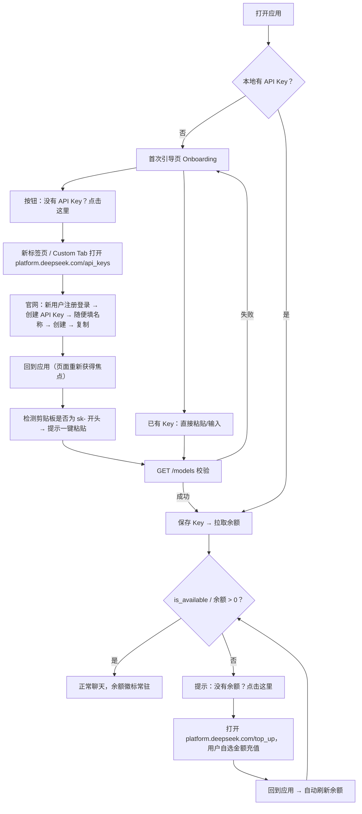

# my-whale 二次开发文档：首次引导、实时余额与安卓版

> 基线代码：`vender/chat-demo`（deepseek-ai/chat-demo v0.1.1，提交 `5d5dd75`）
> 文档日期：2026-11-17

---

## 1. 背景与目标

chat-demo 是**纯前端静态应用**：API Key 保存在浏览器 `localStorage`，浏览器直接请求 `https://api.deepseek.com`，没有自己的后端。
目前首次打开时只会弹出「设置 → 数据管理」，里面只有一个 API Key 输入框，新用户不知道去哪里拿 Key。

本次二次开发要做的事：

| # | 需求 | 平台 |
|---|------|------|
| F1 | 首次启动显示引导页，提供「没有 API Key？点击这里」按钮，跳转到 https://platform.deepseek.com/api_keys | Web + Android |
| F2 | 引导用户在官网注册/登录 → 创建 API Key → 复制 → 回到本应用粘贴（提供「从剪贴板粘贴」按钮） | Web + Android |
| F3 | 实时显示账户余额（调用 DeepSeek 官方余额接口） | Web + Android |
| F4 | 「没有余额？点击这里」按钮，跳转到 https://platform.deepseek.com/top_up，用户自己选择充值金额 | Web + Android |
| F5 | 安卓 App，功能与网页版一致 | Android |

> [!IMPORTANT]
> **API Key 不能自动回填**。DeepSeek 开放平台没有 OAuth 授权，也不提供跨站回传 Key 的方式，所以「创建 Key → 复制 → 粘贴」这一步必须由用户手动完成。我们能做的是尽量减少操作：提供分步说明、一键「从剪贴板粘贴」，以及回到页面时自动检测剪贴板。**不要**用 WebView 注入脚本去抓取官网页面上的 Key，这样有安全和合规风险。

---

## 2. 用户流程



---

## 3. 官方接口与链接

### 3.1 外部链接（统一管理）

| 常量 | 地址 | 用途 |
|---|---|---|
| `PLATFORM_API_KEYS_URL` | https://platform.deepseek.com/api_keys | 获取 API Key（未登录时官网会自动进入注册/登录） |
| `PLATFORM_TOP_UP_URL` | https://platform.deepseek.com/top_up | 充值 |
| `PLATFORM_USAGE_URL`（可选） | https://platform.deepseek.com/usage | 用量明细 |

> 现有代码在 [AssistantMessage.tsx](file:///e:/my-whale/vender/chat-demo/src/components/messages/AssistantMessage.tsx#L27) 里硬编码了 `TOP_UP_URL`，应迁移到下文的 `links.ts` 中统一管理。

### 3.2 余额接口

```
GET https://api.deepseek.com/user/balance
Authorization: Bearer <API Key>
Accept: application/json
```

响应示例：

```json
{
  "is_available": true,
  "balance_infos": [
    {
      "currency": "CNY",
      "total_balance": "110.00",
      "granted_balance": "10.00",
      "topped_up_balance": "100.00"
    }
  ]
}
```

| 字段 | 说明 |
|---|---|
| `is_available` | 余额是否足够调用 API；为 `false` 时调用会返回 `402` |
| `currency` | `CNY` 或 `USD`，可能同时返回多个币种 |
| `total_balance` | 可用总余额 = 赠送余额 + 充值余额（**字符串**，展示前不要用浮点数做运算） |
| `granted_balance` | 赠送余额（会优先扣除） |
| `topped_up_balance` | 充值余额 |

> [!WARNING]
> **开发第一步先验证跨域（CORS）**：现有的 `/models` 以及聊天、文件等接口已经能从浏览器直接访问，但 `/user/balance` 是否返回 `Access-Control-Allow-Origin` 需要实测。在 `pnpm dev` 页面的控制台执行：
> ```js
> fetch('https://api.deepseek.com/user/balance', { headers: { Authorization: 'Bearer sk-xxx' } }).then(r => r.json()).then(console.log)
> ```
> - 能拿到数据 → 按本文方案直接调用。
> - 被 CORS 拦截 → Web 端开发环境用 `devServer.proxy` 代理；生产环境需要加一层极简反向代理（如 Cloudflare Worker 或 Nginx，只透传 `/user/balance`，**不记录 Key**）。Android 端改用 `CapacitorHttp` 原生请求，不受 CORS 限制（见第 6 章）。

---

## 4. 现有代码中相关的位置

| 位置 | 现状 | 改动 |
|---|---|---|
| [App.tsx](file:///e:/my-whale/vender/chat-demo/src/app/App.tsx#L70-L74) | 启动时调用 `ensureApiKey()`，没有 Key 就打开设置弹窗 | 没有 Key 时改为打开**引导页** |
| [settingsDialogState.ts](file:///e:/my-whale/vender/chat-demo/src/components/settings/settingsDialogState.ts#L19-L25) | `ensureApiKey()` 打开设置的「数据管理」 | 改为打开引导页（发送消息、上传附件等地方都会调用它） |
| [ApiKeyField.tsx](file:///e:/my-whale/vender/chat-demo/src/components/settings/ApiKeyField.tsx) | 设置里的 Key 输入框 | 增加「获取 API Key」链接和「粘贴」按钮；下方显示余额 |
| [useApiKeyForm.ts](file:///e:/my-whale/vender/chat-demo/src/components/settings/useApiKeyForm.ts) | 用 `GET /models` 校验后保存 | 引导页直接复用；保存成功后触发余额刷新 |
| [client.ts](file:///e:/my-whale/vender/chat-demo/src/services/api/client.ts#L93-L99) | `verifyApiKey`、`request` | 新增 `getBalance` |
| [describe.ts](file:///e:/my-whale/vender/chat-demo/src/services/chat/describe.ts#L37-L38) | 402 时已有 `action: 'topUp'` | 402 时同时把余额状态设为「不足」 |
| [Sider.tsx](file:///e:/my-whale/vender/chat-demo/src/components/sider/Sider.tsx) / `MobileHeader.tsx` | 侧边栏、移动端顶部栏 | 放置余额徽标 |
| `i18n/zh.ts`、`i18n/en.ts` | 中英文文案 | 新增文案 key（见 5.7） |

---

## 5. 网页版实现方案

### 5.1 新增文件一览

```text
src/
  services/
    links.ts                       # 外部链接常量 + openExternal()
    balance.ts                     # 余额 zustand store + 刷新策略
    clipboard.ts                   # 读取剪贴板、识别 sk- Key（可与 utils/clipboard.ts 合并）
    api/client.ts                  # + getBalance()
  components/
    onboarding/
      Onboarding.tsx               # 首次引导页（全屏 Modal）
      Onboarding.module.css
      onboardingState.ts           # open / close
    balance/
      BalanceBadge.tsx             # 余额徽标（侧边栏 / 顶部栏 / 设置）
      BalanceBadge.module.css
      TopUpLink.tsx                # 「没有余额？点击这里」
```

### 5.2 `services/links.ts`

```ts
export const PLATFORM_API_KEYS_URL = 'https://platform.deepseek.com/api_keys'
export const PLATFORM_TOP_UP_URL = 'https://platform.deepseek.com/top_up'

/** 打开外部链接。Web 端用新标签页；Android 端在第 6 章替换为 Custom Tabs */
export let openExternal = (url: string) => {
  window.open(url, '_blank', 'noopener,noreferrer')
}

/** Android 壳启动时注入原生实现 */
export const setOpenExternal = (impl: (url: string) => void) => {
  openExternal = impl
}
```

### 5.3 `api/client.ts` 新增 `getBalance`

```ts
export type BalanceInfo = {
  currency: 'CNY' | 'USD' | string
  total_balance: string
  granted_balance: string
  topped_up_balance: string
}
export type BalanceResponse = { is_available: boolean; balance_infos: BalanceInfo[] }

/** GET /user/balance 查询余额（不产生费用） */
export const getBalance = async (apiKey: string, signal?: AbortSignal): Promise<BalanceResponse> => {
  const response = await request(`${API_ORIGIN}/user/balance`, {
    method: 'GET',
    headers: { Authorization: `Bearer ${apiKey}`, Accept: 'application/json' },
    signal,
  })
  return (await response.json()) as BalanceResponse
}
```

> 复用现有的 `request()`，错误会自动转成 `ApiError`，`classifyApiError` 能识别 401、402 和网络错误。

### 5.4 `services/balance.ts`：余额状态与「实时」刷新策略

由于没有推送通道，「实时」通过**事件触发 + 定时轮询**来实现：

| 触发时机 | 说明 |
|---|---|
| API Key 保存成功 | 立即拉取 |
| 应用启动且已有 Key | 立即拉取 |
| 每次回复结束（`message_stop` 或出错） | 回复会消耗余额，结束后刷新（防抖 2 秒） |
| 页面重新获得焦点 / `visibilitychange` 变为可见 | **从充值页回来后自动刷新**，这是关键体验 |
| 页面可见时每 60 秒轮询一次 | 页面隐藏时暂停 |
| 用户点击余额徽标上的刷新按钮 | 手动刷新 |
| 聊天接口返回 402 | 直接将状态设为 `insufficient`，再补拉一次 |

```ts
import { create } from 'zustand'
import { getBalance, type BalanceResponse } from './api/client.js'
import { classifyApiError } from './api/errors.js'
import { useSettings } from './settings.js'

type BalanceState = {
  status: 'idle' | 'loading' | 'ok' | 'insufficient' | 'error' | 'unauthorized'
  data: BalanceResponse | null
  updatedAt: number | null
}

export const useBalance = create<BalanceState>(() => ({ status: 'idle', data: null, updatedAt: null }))

let controller: AbortController | null = null

export const refreshBalance = async () => {
  const apiKey = useSettings.getState().apiKey
  if (!apiKey) return useBalance.setState({ status: 'idle', data: null })
  controller?.abort()
  controller = new AbortController()
  useBalance.setState((s) => ({ status: s.data ? s.status : 'loading' })) // 有旧数据时不闪烁
  try {
    const data = await getBalance(apiKey, controller.signal)
    const empty = !data.is_available || data.balance_infos.every((b) => Number(b.total_balance) <= 0)
    useBalance.setState({ data, status: empty ? 'insufficient' : 'ok', updatedAt: Date.now() })
  } catch (e) {
    if (controller.signal.aborted) return
    const kind = classifyApiError(e)
    useBalance.setState({ status: kind === 'unauthorized' ? 'unauthorized' : kind === 'insufficientBalance' ? 'insufficient' : 'error' })
  }
}

/** 在 App 挂载时调用一次，返回清理函数 */
export const bindBalanceAutoRefresh = () => {
  const onVisible = () => document.visibilityState === 'visible' && void refreshBalance()
  document.addEventListener('visibilitychange', onVisible)
  window.addEventListener('focus', onVisible)
  const timer = window.setInterval(onVisible, 60_000)
  const unsub = useSettings.subscribe((s, prev) => s.apiKey !== prev.apiKey && void refreshBalance())
  void refreshBalance()
  return () => {
    document.removeEventListener('visibilitychange', onVisible)
    window.removeEventListener('focus', onVisible)
    clearInterval(timer)
    unsub()
  }
}

export const markInsufficient = () => useBalance.setState({ status: 'insufficient' })
```

接入点：
- `App.tsx`：`useEffect(bindBalanceAutoRefresh, [])`
- `services/chat/reply.ts` 或 `store.ts`：回复结束的回调中调用 `debouncedRefreshBalance()`
- `describe.ts` 判断为 `insufficientBalance` 的地方调用 `markInsufficient()`（或者在 store 写入错误时调用，避免在渲染函数里产生副作用）

### 5.5 首次引导页 `Onboarding.tsx`

**显示条件**：`!useSettings.getState().apiKey`。`ensureApiKey()` 改为打开引导页；设置里的 Key 编辑功能保留，供老用户修改。

**页面结构**（桌面端用居中卡片，移动端全屏）：

```
┌──────────────────────────────────────────┐
│  🐳 欢迎使用 my-whale                     │
│  使用前需要一个 DeepSeek API Key          │
│                                          │
│  ① [ 没有 API Key？点击这里 ↗ ]   (主按钮) │
│     新用户会先进入注册/登录页面           │
│  ② 在官网点击「创建 API Key」，名称随便填  │
│     → 创建 → 复制                         │
│  ③ 回到这里粘贴：                         │
│     [ sk-••••••••••••• ] [粘贴] [确定]    │
│     ⚠ 错误提示                           │
│                                          │
│  ─────────────────────────────────────── │
│  余额：¥110.00（校验通过后显示）          │
│  [ 没有余额？点击这里充值 ↗ ]  (次按钮)    │
│                                          │
│  [ 开始聊天 ]  (余额正常后才可点)          │
└──────────────────────────────────────────┘
```

交互细节：
1. **按钮 ①**：调用 `openExternal(PLATFORM_API_KEYS_URL)`，同时记录 `awaitingKey = true`。
2. **回到页面时**：如果 `awaitingKey` 为 true 且页面重新获得焦点，就尝试 `navigator.clipboard.readText()`；读到的内容匹配 `/^sk-[A-Za-z0-9]{20,}$/` 时，自动填入输入框并提示「检测到剪贴板中的 API Key，已为你填入」。**不要自动提交**，让用户确认。
   - 读取剪贴板需要用户授权；被拒绝或浏览器不支持（Firefox、`file://`）时静默失败，只保留「粘贴」按钮。
3. **「粘贴」按钮**：用户主动点击后再调用 `readText()`，成功率最高。
4. **确定**：复用 `useApiKeyForm().submit()` 校验 `/models`，成功后自动 `refreshBalance()`。
5. **余额区**：
   - `ok`：显示余额，主按钮变为「开始聊天」，点击后关闭引导页。
   - `insufficient`：显示红色提示「当前余额不足」以及「没有余额？点击这里」按钮，按钮调用 `openExternal(PLATFORM_TOP_UP_URL)`；用户回来时会自动刷新余额，变为 `ok` 后自动解除提示。也允许点击「稍后充值，先进入」。
   - `error`：显示「余额获取失败，[重试]」，不阻止进入应用（避免因为 CORS 或网络问题卡住用户）。

### 5.6 余额徽标 `BalanceBadge.tsx`

| 位置 | 形式 |
|---|---|
| 桌面端侧边栏底部（设置按钮上方） | `余额 ¥110.00 ⟳`，悬停显示「赠送 ¥10.00 / 充值 ¥100.00 · 更新于 20:10」 |
| 移动端 `MobileHeader` 右侧 | 简短的 `¥110` |
| 设置 → 数据管理，API Key 下方 | 完整余额 + 「去充值」链接 |
| 余额不足时 | 徽标变红，并在其下方显示 `TopUpLink`「没有余额？点击这里」 |

格式化规则：`CNY` 显示为 `¥`，`USD` 显示为 `$`；有多个币种时按 `CNY / USD` 并列显示；直接显示接口返回的字符串，不做浮点运算。

`AssistantMessage.tsx` 中已有的 402「充值」链接改为使用 `PLATFORM_TOP_UP_URL` 和 `openExternal`，保证 Android 端也能用 Custom Tabs 打开。

### 5.7 新增文案（i18n）

| key | zh | en |
|---|---|---|
| `onboardingTitle` | 欢迎使用 my-whale | Welcome to my-whale |
| `onboardingDesc` | 使用前需要一个 DeepSeek API Key | You need a DeepSeek API Key to get started |
| `noApiKeyCta` | 没有 API Key？点击这里 | No API Key? Click here |
| `noApiKeyHint` | 新用户会先进入注册/登录页面 | New users will be asked to sign up first |
| `onboardingStep2` | 在官网点击「创建 API Key」，名称随便填，创建后复制 | Click "Create API Key", enter any name, then copy it |
| `pasteFromClipboard` | 粘贴 | Paste |
| `clipboardKeyDetected` | 检测到剪贴板中的 API Key，已为你填入 | API Key detected in clipboard and filled in |
| `balanceLabel` | 余额 | Balance |
| `balanceDetail` | 赠送 {granted} / 充值 {toppedUp} | Granted {granted} / Topped up {toppedUp} |
| `balanceUpdatedAt` | 更新于 {time} | Updated at {time} |
| `balanceInsufficient` | 当前余额不足 | Insufficient balance |
| `noBalanceCta` | 没有余额？点击这里 | Out of balance? Click here |
| `balanceLoadFailed` | 余额获取失败 | Failed to load balance |
| `startChatting` | 开始聊天 | Start chatting |
| `skipTopUp` | 稍后充值，先进入 | Top up later |

> 余额不足时**允许进入**（已确认）：「稍后充值，先进入」始终可点，进入后侧边栏余额徽标保持红色，并显示「没有余额？点击这里」。

### 5.8 安全与隐私

- API Key 依旧只保存在本地 `localStorage`，不经过任何自建服务器（如果因为 CORS 不得不加代理，代理必须只做透传、不记录日志，并在 README 中说明）。
- 读取剪贴板只在用户点击「粘贴」或者从官网返回时进行，**不上传、不记录**剪贴板内容。
- 所有外部链接带 `rel="noopener noreferrer"`。

---

## 6. 安卓版方案

### 6.1 技术选型

| 方案 | 优点 | 缺点 | 结论 |
|---|---|---|---|
| **Capacitor 封装现有 Web 代码** | 复用 100% 的 UI 和业务逻辑；Web 和安卓同步迭代；体积小 | 原生体验略逊于纯原生 | ✅ **推荐** |
| Kotlin + Jetpack Compose 纯原生重写 | 体验最好 | 需要重写聊天、Markdown、KaTeX、Mermaid、分支、导入导出等所有功能，工作量大 | ❌ 暂不考虑 |
| 简单 WebView 壳（自己写） | 简单 | 文件上传、录音权限、返回键、外链等都要自己处理 | ❌ |

### 6.2 工程结构

```text
my-whale/
  vender/chat-demo/          # 上游源码（尽量少改，便于后续合并上游更新）
  apps/
    android/                 # npx cap add android 生成
  capacitor.config.ts
  docs/
```

> 也可以直接在 `vender/chat-demo` 里执行 `cap init`。如果打算长期跟进上游更新，建议把我们的改动放在单独的分支上，并定期 `git merge upstream/main`。

### 6.3 初始化步骤

```powershell
cd vender/chat-demo
pnpm add @capacitor/core @capacitor/android @capacitor/browser @capacitor/app @capacitor/clipboard
pnpm add -D @capacitor/cli
npx cap init my-whale com.mywhale.app --web-dir dist
pnpm build            # 注意：Windows 下需要先修复构建脚本，见 6.8
npx cap add android
npx cap sync android
npx cap open android  # 用 Android Studio 打开、运行和打包
```

`capacitor.config.ts`：

```ts
import type { CapacitorConfig } from '@capacitor/cli'
const config: CapacitorConfig = {
  appId: 'com.mywhale.app',
  appName: 'my-whale',
  webDir: 'dist',
  android: { allowMixedContent: false },
  plugins: {
    CapacitorHttp: { enabled: true }, // 原生发送 fetch 请求，绕开 WebView 的 CORS 限制（余额接口用得上）
  },
}
export default config
```

> [!WARNING]
> `CapacitorHttp` 开启后会全局接管 `fetch`。聊天接口依赖 **SSE 流式响应**，而 CapacitorHttp 会把响应体缓冲后一次性返回，**会让流式输出失效**。因此：
> - 如果 3.2 节验证结果表明 `/user/balance` 支持 CORS → **不要开启** CapacitorHttp，全部请求走 WebView 原生 `fetch` 即可。
> - 如果不支持 → 保持 `enabled: false`，只在 `getBalance` 里显式调用 `CapacitorHttp.get()`（见 6.4）。

### 6.4 平台适配层

新增 `src/platform/native.ts`，在 `main.tsx` 里根据 `Capacitor.isNativePlatform()` 判断后加载：

```ts
import { Capacitor, CapacitorHttp } from '@capacitor/core'
import { Browser } from '@capacitor/browser'
import { App } from '@capacitor/app'
import { Clipboard } from '@capacitor/clipboard'
import { setOpenExternal } from '../services/links.js'
import { refreshBalance } from '../services/balance.js'

export const setupNative = () => {
  if (!Capacitor.isNativePlatform()) return

  // 1. 外链用 Chrome Custom Tabs 打开（应用内浏览器，保留官网登录状态，点关闭直接回到 App）
  setOpenExternal((url) => void Browser.open({ url, presentationStyle: 'popover' }))

  // 2. 从官网/充值页返回：Custom Tab 关闭或 App 回到前台时刷新余额并检测剪贴板
  Browser.addListener('browserFinished', () => void onReturn())
  App.addListener('resume', () => void onReturn())

  // 3. 安卓返回键：先关闭弹窗或抽屉，再后退，最后退出
  App.addListener('backButton', ({ canGoBack }) => { /* 关闭 Modal / 抽屉 → history.back() → App.exitApp() */ })
}

const onReturn = async () => {
  void refreshBalance()
  const { value } = await Clipboard.read().catch(() => ({ value: '' }))
  if (/^sk-[A-Za-z0-9]{20,}$/.test(value)) {
    window.dispatchEvent(new CustomEvent('mywhale:clipboard-key', { detail: value }))
  }
}

/** CORS 不通时，供 getBalance 使用的原生请求 */
export const nativeGet = (url: string, headers: Record<string, string>) =>
  CapacitorHttp.get({ url, headers }).then((r) => r.data)
```

引导页监听 `mywhale:clipboard-key` 事件，收到后自动填入输入框（与 Web 端的 `focus` 检测逻辑共用同一套代码）。

### 6.5 安卓端流程对照

| 步骤 | Web | Android |
|---|---|---|
| 打开获取 Key 页面 | 新标签页 | Chrome Custom Tab（应用内浏览器） |
| 新用户注册 | 官网自动跳转注册 | 同左（Custom Tab 与 Chrome 共享 Cookie，已登录 Chrome 的用户免登录） |
| 返回应用 | 切回标签页 → `focus` | 关闭 Custom Tab → `browserFinished` / `resume` |
| 读取剪贴板 | `navigator.clipboard`（需授权） | `@capacitor/clipboard`（Android 12+ 系统会弹出「已读取剪贴板」提示，属于正常现象） |
| 余额请求 | `fetch` | `fetch`；CORS 不通时用 `CapacitorHttp` |
| 充值 | 新标签页打开 top_up | Custom Tab 打开 top_up，支付宝/微信支付会唤起对应 App |
| 充值后刷新 | `visibilitychange` | `resume` |

### 6.6 安卓必需的配置

`android/app/src/main/AndroidManifest.xml`：

```xml
<uses-permission android:name="android.permission.INTERNET" />
<uses-permission android:name="android.permission.RECORD_AUDIO" />       <!-- 语音输入 -->
<uses-permission android:name="android.permission.MODIFY_AUDIO_SETTINGS" />
<queries>
  <intent><action android:name="android.support.customtabs.action.CustomTabsService" /></intent>
</queries>
```

其他检查项：
- **录音**：Capacitor 的 WebChromeClient 会处理 `getUserMedia` 的权限请求，但首次使用前需要在运行时申请 `RECORD_AUDIO`，可以在点击麦克风按钮时调用原生权限请求。
- **文件上传**：`<input type="file">` 由 Capacitor 自动处理，需要在真机上测试相册、相机、文件三种来源。
- **历史导出 ZIP**：WebView 里 `<a download>` 不能直接用，需要改用 `@capacitor/filesystem` + `@capacitor/share` 保存或分享文件。
- **Mermaid / KaTeX**：资源已经打包进 `dist`，离线可用，无需额外处理。
- `minSdkVersion` 建议设为 24 或更高（WebView 需要 Chrome 105+ 内核，与 rspack 的 `targets` 一致），并在应用内提示用户更新 Android System WebView。
- 签名：在 Android Studio 中依次选择 `Build → Generate Signed Bundle/APK`，生成的 keystore 要妥善保管，**不要提交到 git**。

### 6.7 APK 分发（不上架应用商店）

- **签名**：使用固定的 release keystore（`my-whale-release.jks`），**以后每个版本都必须用同一个签名**，否则用户无法覆盖安装。keystore 和密码离线备份，不提交到 git；`android/keystore.properties` 加入 `.gitignore`。
- **产物**：`Build → Generate Signed Bundle/APK → APK`，选择 release，文件命名为 `my-whale-v{versionName}.apk`。为了兼容更多机型，打 universal APK（不按 ABI 拆分）。
- **版本号**：`versionName` 与 `package.json` 的 `version` 保持一致；`versionCode` 每次发版加 1。
- **安装说明**：用户需要在系统中允许“安装未知来源应用”；发布页提供 SHA-256 校验值，方便用户核对安装包。
- **更新检查（可选）**：启动时请求一个静态的 `version.json`（`{ "versionCode": 3, "url": "...apk", "notes": "..." }`），发现新版本时提示用户下载，不做静默更新。
- 因为不上架，不需要准备商店截图、商店隐私问卷等材料；但应用内仍需提供一页简短的隐私说明（数据只存在本机，聊天内容会发送给 DeepSeek API）。

### 6.8 Windows 下的构建脚本修复

`package.json` 里的 `build` 用了 `rm -rf` 和 `NODE_ENV=production`，在 PowerShell 中不能运行。修改方式：

```powershell
pnpm add -D rimraf cross-env
```

```json
"build": "rimraf dist && cross-env NODE_ENV=production rspack build -c rspack.config.ts",
"android": "pnpm build && npx cap sync android && npx cap open android"
```

---

## 7. 开发任务拆分与排期（参考）

| # | 任务 | 平台 | 预估 |
|---|---|---|---|
| T0 | 验证 `/user/balance` 的 CORS；修复 Windows 构建脚本 | 通用 | 0.5 天 |
| T1 | 新增 `links.ts`、`getBalance`、`balance.ts`（含刷新策略） | 通用 | 1 天 |
| T2 | 引导页 Onboarding + 剪贴板检测 + 修改 `ensureApiKey` | 通用 | 1.5 天 |
| T3 | 余额徽标（侧边栏、顶部栏、设置）+ TopUpLink + 402 联动 | 通用 | 1 天 |
| T4 | i18n 文案、深色主题样式、移动端适配 | 通用 | 0.5 天 |
| T5 | Capacitor 初始化、平台适配层、返回键处理 | Android | 1 天 |
| T6 | 录音权限、文件上传、ZIP 导出适配 | Android | 1 天 |
| T7 | 真机联调、release 签名、打包 APK、发布页与更新检查 | Android | 1 天 |
| | **合计** | | **约 7.5 天** |

---

## 8. 验收标准

**Web**
- [ ] 清空 `localStorage` 后打开应用，显示引导页而不是设置弹窗
- [ ] 点击「没有 API Key？点击这里」在新标签页打开 `platform.deepseek.com/api_keys`；未登录时进入注册/登录
- [ ] 在官网复制 Key 后切回本页面，Key 被自动识别并填入（浏览器已授权剪贴板时）；「粘贴」按钮始终可用
- [ ] 输入无效 Key 提示「API Key 无效」；有效 Key 保存后 2 秒内显示余额
- [ ] 余额为 0 或 `is_available=false` 时显示「没有余额？点击这里」，点击后打开 `platform.deepseek.com/top_up`
- [ ] 充值完成后切回页面，余额在 2 秒内自动更新，提示消失
- [ ] 每次对话结束后余额自动刷新；页面隐藏时不再轮询
- [ ] 余额接口失败时不影响正常聊天
- [ ] 中英文、深浅色主题、移动端布局显示正常

**Android**
- [ ] 以上 Web 用例在 App 中全部通过（外链改为 Custom Tab 打开）
- [ ] 关闭 Custom Tab 或从支付 App 返回后余额自动刷新
- [ ] 聊天流式输出正常（确认没有被 CapacitorHttp 缓冲）
- [ ] 语音输入、朗读、附件上传、历史导出正常
- [ ] 返回键行为正确：先关弹窗，再后退，最后退出
- [ ] release APK 可以在 Android 7.0+ 真机上安装；新版本 APK 能覆盖安装旧版本，且数据不丢失
- [ ] 余额为 0 时点击「稍后充值，先进入」可以正常进入应用

---

## 9. 风险与应对

| 风险 | 影响 | 应对 |
|---|---|---|
| `/user/balance` 不支持 CORS | Web 端无法直接查询余额 | 加透传代理；Android 端用 CapacitorHttp |
| 官网页面或 URL 改版 | 跳转后找不到对应页面 | 链接集中放在 `links.ts`，方便修改 |
| 浏览器拒绝读取剪贴板 | 无法自动填入 | 保留手动「粘贴」按钮和输入框 |
| 跟进上游更新时冲突 | 合并成本高 | 新功能尽量放在新文件中，对上游文件只做少量改动 |
| 品牌与商标 | 可能引起用户误以为是官方应用 | App 名称和图标不要使用 DeepSeek 商标；在关于页注明「第三方客户端」 |
| APK 签名丢失 | 用户无法覆盖升级 | keystore 多处离线备份 |

## 10. 已确认决策（2026-11-17）

| 事项 | 结论 |
|---|---|
| 应用名称 / 包名 | `my-whale` / `com.mywhale.app` |
| 余额不足时 | **允许进入**：引导页显示「没有余额？点击这里」以及「稍后充值，先进入」，不阻止用户使用 |
| 安卓发布方式 | **只分发 APK**，不上架应用商店（详见 6.8） |
